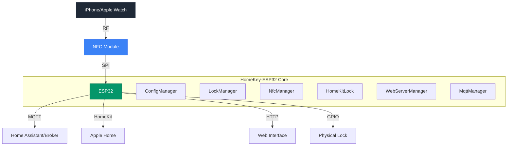

<div align="center">
  

  # HomeKey-ESP32
  [](https://discord.com/invite/VWpZ5YyUcm)
  [](https://github.com/rednblkx/HomeKey-ESP32/actions/workflows/esp32.yml)
  [](LICENSE)
  
  **Apple HomeKey functionality for the rest of us**

  [Documentation](https://rednblkx.github.io/HomeKey-ESP32/)

</div>

## What is HomeKey-ESP32?

The project aims to be the easy DIY solution for using Apple's HomeKey feature without the need to purchase a compatible smart lock that you probably don't want. HomeKey-ESP32 brings Apple's secure NFC-based unlocking to an ESP32 module near you, enabling you to unlock doors and whatnot with a simple tap of your iPhone or Apple Watch.

**No proprietary hardware required** – just an ESP32 and one of the supported NFC modules

> [!WARNING]
> `enc.firmware.ota.bin` and `enc.firmware.factory.bin` release artifacts have Flash Encryption enabled and **disables** UART and USB/JTAG download
>
> Flashing this variant will render tools like `esptool` useless and any future updates will only be done through the project's OTA implementation
> 
> You have been warned. Also DO NOT attempt to update from a unencrypted version due to bootloader and partition table being different.
>
> Additionally, the flash encryption is provided as is and DOES NOT provide any guarantee of a bulletproof solution against attacks, but attempts
> to diminish the attack surface.


## Getting Started

> [!TIP]
> A wiki documenting the project can be found at https://rednblkx.github.io/HomeKey-ESP32/

### Prerequisites

- **ESP32 Development Board**
- **NFC reader** - one of:
  - **PN532** (SPI)
  - **PN7161** (SPI) - available in the dev release
  - **ST25R3916** (I2C) - available in the dev release
- **USB Cable** (for flashing and power)
- **Computer** (Windows, Mac, or Linux)
- **Basic Electronics Knowledge** (not a problem if you're new to this, ask away!)

#### Ethernet

The following chips are supported for Ethernet:

-  W5500
-  DM9051
-  KSZ8851
-  LAN8720 / LAN8710
-  TLK110
-  RTL8201
-  DP83848
-  KSZ8041
-  KSZ8081

> [!IMPORTANT]
>
> The following are only supported for ESP32-WROOM-32 boards as other variants lack the internal EMAC needed for the RMII interface:
> -  LAN8720 / LAN8710
> -  TLK110
> -  RTL8201
> -  DP83848
> -  KSZ8041
> -  KSZ8081

### Installation Steps

1. **Download Firmware**
   - Visit [GitHub Releases](https://github.com/rednblkx/HomeKey-ESP32/releases/latest)
   - Download the `*.firmware.factory.bin` file
   - This contains everything you need - no compilation required!

2. **Connect Your Hardware**
   - Wire your chosen NFC module to your ESP32 using the default pins
   - Refer to the [detailed wiring guide](https://rednblkx.github.io/HomeKey-ESP32/setup/#21-nfc-module-wiring) for your specific setup

3. **Flash the Firmware**
   ```bash
   # Install esptool (one-time setup)
   pip install esptool
   
   # Flash the firmware (replace YOUR_PORT)
   esptool.py --port /dev/ttyUSB0 write_flash 0x0 firmware.factory.bin
   ```
   
   **Prefer a GUI?** Use the [browser-based flasher](https://espressif.github.io/esptool-js/) - no command line needed!

4. **Initial Setup**
   - Connect to the device's WiFi AP (`HomeSpan-Setup` / `homespan`)
   - Access the web interface at `http://192.168.4.1`
   - Configure your WiFi credentials and HomeKit setup code
   - Pair with Apple Home using code: `466-37-726`

5. **Start Using HomeKey!**
   - Hold your iPhone or Apple Watch near the NFC reader
   - Enjoy instant, secure access to your home! 🎉

### Updating

Follow the update in the documentation at: https://rednblkx.github.io/HomeKey-ESP32/updates/

## System Architecture

<div align="center">
  


</div>

## ✨ Key Features

### **Apple HomeKey Integration**
- **Express Mode**: Unlock without waking your device
- **Power Reserve**: Unlock even when the device needs to be charged
- **Multi-Device Support**: Works with iPhone and Apple Watch
- **Fast Authentication**: Sub-300ms unlock times

### **Smart Home Ready**
- **HomeKit Native**: Full Apple Home ecosystem integration
- **MQTT Support**: Connect to Home Assistant, OpenHAB, and other platforms
- **Home Assistant Discovery**: Automatic device detection and configuration
- **Custom States**: Support for complex lock states (jamming, unlocking, etc.)

### **Modern Web Interface**
- **Svelte Frontend**: Responsive, modern UI built with Svelte 5 + Tailwind CSS
- **Real-time Updates**: WebSocket-powered live status updates
- **OTA Updates**: Over-the-air firmware updates via web interface
- **Configuration Management**: Easy setup without recompiling

### **Developer Friendly**
- **Open Source**: MIT licensed, community-driven development
- **Modular Architecture**: Clean separation of concerns
- **Event System**: Pub/sub architecture for extensibility
- **Comprehensive Logging**: Debug and monitor with detailed logs

## Development

```mermaid
graph TD
  %% External Systems & Hardware
  subgraph "External World"
      A[iPhone / Apple Watch]
      B[Apple Home]
      C[Web Browser]
      D[MQTT Broker]
      E[Physical Lock, Buttons & LEDs]
  end

  %% Main Application on ESP32
  subgraph "HomeKey-ESP32 Core"
      
      subgraph "Interface Managers (I/O)"
          direction LR
          Nfc[NfcManager]
          HK[HomeKitLock]
          Web[WebServerManager]
          Mqtt[MqttManager]
          Hw[HardwareManager]
      end

      subgraph "Logic Core (State Machine)"
          Lock[LockManager]
      end

      subgraph "Data Services (Persistence)"
          direction LR
          Config[ConfigManager]
          Reader[ReaderDataManager]
          NVS[(NVS Storage)]
      end

      %% High-level Data and Control Flow
      DataServices[Data Services] -- "Provides Config & Reader Data" --> InterfaceManagers[Interface Managers]
      DataServices -- "Provides Config" --> LogicCore[Logic Core]
      Config -- "Reads/Writes" --> NVS
      Reader -- "Reads/Writes" --> NVS
      
      InterfaceManagers -- "State Change Requests (e.g., Unlock)" --> Lock
      Lock -- "Actions & State Updates" --> InterfaceManagers
  end
  
  %% Connections to the External World
  A -- NFC --> Nfc
  B -- HomeKit --> HK
  C -- HTTP/WebSocket --> Web
  D -- MQTT --> Mqtt
  E -- GPIO --> Hw
  
  Hw -- GPIO --> E
  HK -- HomeKit --> B
  Web -- HTTP/WebSocket --> C
  Mqtt -- MQTT --> D

  %% Styling for clarity
  style A fill:#1f2937,stroke:#374151,color:#fff
  style B fill:#1f2937,stroke:#374151,color:#fff
  style C fill:#1f2937,stroke:#374151,color:#fff
  style D fill:#1f2937,stroke:#374151,color:#fff
  style E fill:#1f2937,stroke:#374151,color:#fff

  style Nfc fill:#3b82f6,stroke:#2563eb,color:#fff
  style HK fill:#059669,stroke:#047857,color:#fff
  style Web fill:#f59e0b,stroke:#d97706,color:#fff
  style Mqtt fill:#ef4444,stroke:#dc2626,color:#fff
  style Hw fill:#8b5cf6,stroke:#7c3aed,color:#fff

  style Lock fill:#ec4899,stroke:#db2777,color:#fff
  
  style Config fill:#6b7280,stroke:#4b5563,color:#fff
  style Reader fill:#6b7280,stroke:#4b5563,color:#fff
  style NVS fill:#9ca3af,stroke:#6b7280,color:#fff
```

<div align="center">
  


</div>

### Project Structure

```
HomeKey-ESP32/
├── main/                    # Core ESP32 application
│   ├── main.cpp            # Application entry point
│   ├── ConfigManager.cpp    # Configuration management
│   ├── ReaderDataManager.cpp # Reader data management
│   ├── NfcManager.cpp      # NFC communication
│   ├── Pn532Reader.cpp     # PN532 backend (SPI)
│   ├── Pn7160Reader.cpp    # PN7160 backend
│   ├── St25r3916Reader.cpp # ST25R3916 backend (I2C)
│   ├── HomeKitLock.cpp     # HomeKit integration
│   ├── LockManager.cpp     # Lock state management
│   ├── MqttManager.cpp     # MQTT client
│   ├── WebServerManager.cpp # Web interface
│   ├── WebSocketLogSinker.cpp # WebSocket logging sinker
│   ├── HardwareManager.cpp # Hardware manager
│   └── HKServices.cpp # HomeKit services
├── data/                   # Web interface files
│   ├── src/               # Vue.js application
│   └── index.html         # Web UI entry point
├── components/            # External dependencies
│   ├── HK-HomeKit-Lib/   # HomeKey implementation
│   ├── HomeSpan/         # HomeKit framework
│   └── PN532/            # NFC driver
└── docs/                 # Documentation
    └── content/          # Hugo documentation
```

### Core Components

| Component | File | Purpose |
|-----------|------|---------|
| **NFC Manager** | [`NfcManager.cpp`](main/NfcManager.cpp) | Drives the selected NFC backend and HomeKey authentication |
| **NFC Backends** | [`Pn532Reader.cpp`](main/Pn532Reader.cpp) / [`Pn7160Reader.cpp`](main/Pn7160Reader.cpp) / [`St25r3916Reader.cpp`](main/St25r3916Reader.cpp) | Reader implementations behind the common `INfcReader` interface |
| **HomeKit Bridge** | [`HomeKitLock.cpp`](main/HomeKitLock.cpp) | Manages Apple HomeKit integration and pairing |
| **Lock Manager** | [`LockManager.cpp`](main/LockManager.cpp) | Controls lock state transitions and GPIO actions |
| **MQTT Client** | [`MqttManager.cpp`](main/MqttManager.cpp) | Enables smart home integration via MQTT |
| **Web Server** | [`WebServerManager.cpp`](main/WebServerManager.cpp) | Provides configuration UI and OTA updates |
| **Config Manager** | [`ConfigManager.cpp`](main/ConfigManager.cpp) | Handles persistent configuration storage |

### Building from Source

```bash
# Install dependencies
git submodule update --init --recursive

# Install esp-idf v5.4 or newer -- CI builds against v5.5.4.
# Earlier versions do not compile: the pn7160 and pn532_hal components use
# esp_log_buffer.h and spi_bus_dma_memory_alloc, both introduced in v5.4.
# See https://docs.espressif.com/projects/esp-idf/en/latest/esp32/get-started/index.html#get-started

# Build firmware
idf.py build

# Flash to device
idf.py -p /dev/ttyUSB0 flash

# Monitor output
idf.py monitor
```

## Build & Setup Notes for ESP32-S3

Many ESP32-S3 development boards like the [YD-ESP32-S3 Core Board](https://github.com/Jan21493/YD-ESP32-S3/blob/main/README.md) or similar clones with a 16 MB XMC SPI flash chip (N16R8) may have a problem with the bootloader in combination with ESP-IDF v5.5. The ESP-IDF monitor shows constant reboots that include these messages:

* **With XMC support enabled (`CONFIG_BOOTLOADER_FLASH_XMC_SUPPORT=y`):**
  ```text
  E (26) bootloader_flash: XMC flash startup fail
  E (26) boot.esp32s3: failed when running XMC startup flow, reboot!
  ```
* **With XMC support disabled (`CONFIG_BOOTLOADER_FLASH_XMC_SUPPORT=n`):**
  ```text
  E (24) bootloader_flash: XMC chip detected (00207018) while support disabled.
  E (24) boot.esp32s3: failed when running XMC startup flow, reboot!
  ```

The JEDEC ID of the 16MB XMC SPI flash chip is `0x00207018` (vendor ID: `0x20` = XMC, model ID: `0x70` = XM25QHxxC series, capacity:`0x18` = 16MB). 

In **ESP-IDF v5.5**, the strict chip validation in `bootloader_flash.c` (`is_xmc_chip_strict()`) only checks for model IDs `0x40`, `0x41`, and `0x50`. Because `0x70` is missing, the device enters a boot loop regardless of whether XMC support is enabled or disabled.

#### Solution
1. Open `components/bootloader_support/bootloader_flash/src/bootloader_flash.c` inside your ESP-IDF installation directory.
2. Add the `mfid == 0x70` check to `is_xmc_chip_strict()` after other `mfid == 0x..` checks:
   ```c
   } else if (mfid == 0x70) {
       if (cpid >= 0x15 && cpid <= 0x20) {
           matched = true;
       }
   }
   ```
3. Ensure `CONFIG_BOOTLOADER_FLASH_XMC_SUPPORT=y` is enabled in your `sdkconfig` / `sdkconfig.defaults`.
4. Rebuild and flash the bootloader (`idf.py bootloader` followed by `idf.py bootloader-flash`).


### 2. Flash Configuration & Partition Table (`with_ota.csv`)

* **Flash Size & Speed:** Configure the flash size to match the board, e.g. configure`16MB` for a board with `N16R8`, mode to `DIO`, and SPI speed to `40MHz` in `sdkconfig.defaults`:
  ```ini
  CONFIG_ESPTOOLPY_FLASHMODE_DIO=y
  CONFIG_ESPTOOLPY_FLASHMODE="dio"
  CONFIG_ESPTOOLPY_FLASHFREQ_40M=y
  CONFIG_ESPTOOLPY_FLASHFREQ="40m"
  CONFIG_ESPTOOLPY_FLASHSIZE_16MB=y
  CONFIG_ESPTOOLPY_FLASHSIZE="16MB"
  CONFIG_BOOTLOADER_FLASH_XMC_SUPPORT=y
  ```
* **Web UI Storage (`spiffs`):** The compiled Svelte web interface (`data/dist`) exceeds the default `128KB` (`0x20000`) allocation and triggers an `LFS_ERR_NOSPC` build error. Increase the `spiffs` partition in `with_ota.csv` to at least `512KB` (`0x80000`):
  ```csv
  # Name, Type, SubType, Offset, Size, Flags
  nvs,data,nvs,,0x10000,,
  otadata,data,ota,,0x2000,,
  app0,app,ota_0,,0x1E0000,,
  app1,app,ota_1,,0x1E0000,,
  spiffs,data,spiffs,,0x80000,,
  ```
* **Build Prerequisites:** Ensure **Bun** is installed and symlinked into your system `PATH` (e.g., `/usr/local/bin/bun`) so CMake can bundle the web interface during the build process.


### 3. Hardware Pinout (ESP32-S3 N16R8)

> **Important:** Always enter the **GPIO number** (`IOxx`) in the web configuration, not the physical board pin number. Avoid **GPIO 19 & 20** (reserved for USB-JTAG) and **GPIO 26–37** (reserved for internal flash and Octal PSRAM).

You may use the following GPIOs on your ESP32-S3 board in the web based startup configuration. The development board may also include a NeoPixel / WS2812B RGB-LED connected to GPIO 48.

* **PN532 NFC Reader (SPI Mode):**
  * `SS (SDA / CS)`: **GPIO 10**
  * `MOSI`: **GPIO 11**
  * `SCK`: **GPIO 12**
  * `MISO`: **GPIO 13**
  * *Note:* `RST` and `IRQ` remain unconnected. Set the DIP switches on the PN532 board to **SPI** (`1 = OFF`, `2 = ON`).
* **Onboard RGB Status LED (XL-5050RGBC-WS2812B):**
  * Configure under **Actions** as **Pixel** on **GPIO 48**.Keep color ordering as **GRB**. *(If the LED does not light up, check that the tiny `RGB` solder jumper next to the LED on the devboard is bridged).*


### Contributing

Contributions are welcomed! Please see the [Contributing Guidelines](CONTRIBUTING.md) for details.

1. Fork the repository
2. Create a feature branch (`git checkout -b feature/amazing-feature`)
3. Commit your changes (`git commit -m 'feat: Add amazing feature'`)
4. Push to the branch (`git push origin feature/amazing-feature`)
5. Open a Pull Request against the `main` branch

## Support the Project

HomeKey-ESP32 is openly developed and maintained by the community. Your support helps us continue improving the project.

- **Star the repository** to show your appreciation
- **Report bugs** to help improve stability
- **Suggest features** to guide development
- **Share the project** with your network
- **Contribute documentation** to help others

## Credits

- **[@kormax](https://github.com/kormax)**: Reverse-engineered the HomeKey NFC protocol and published the foundational [PoC implementation](https://github.com/kormax/apple-home-key-reader)
- **[@kupa22](https://github.com/kupa22)**: Researched the HAP (HomeKit Accessory Protocol) side of HomeKey
- **[HomeSpan](https://github.com/HomeSpan/HomeSpan)**: Excellent HomeKit framework that powers our integration
- **[ESP-IDF](https://github.com/espressif/esp-idf)**: Robust IoT development framework from Espressif

## License & Legal

### License

This project is licensed under the **MIT License** - see the [LICENSE](LICENSE) file for details.

### Disclaimer

**Important**: This project implements Apple HomeKey functionality through reverse engineering. While we strive for security and compatibility:

- **Not affiliated** in any shape or form nor condoned by Apple Inc.
- **Use at your own risk** for security-critical applications
- **May lack elements** from Apple's private specifications
- **Subject to change** as Apple updates their protocols

### Trademarks

- **Apple**, **iPhone**, and **Apple Watch** are trademarks of Apple Inc.
- **ESP32** is a trademark of Espressif Systems (Shanghai) Co., Ltd.
- **Home Assistant** is a trademark of Open Home Foundation
